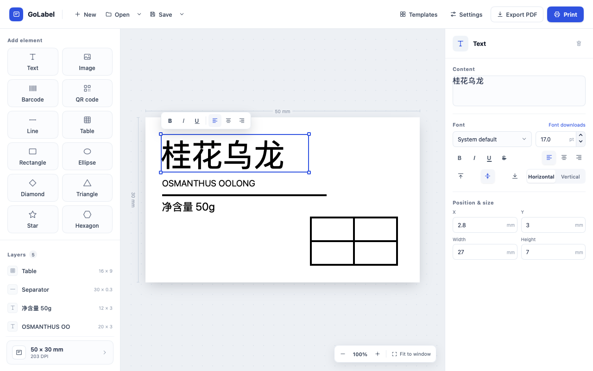
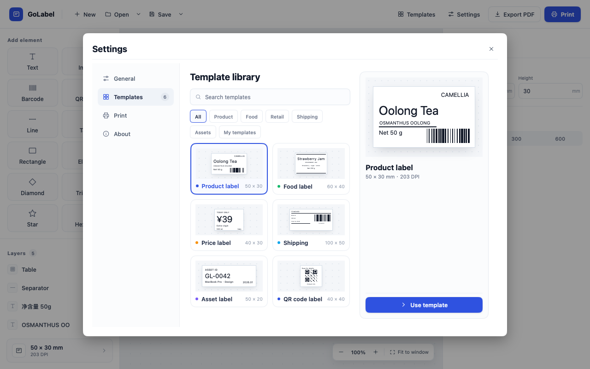

# GoLabel

English · [简体中文](README.zh-CN.md)

A native label editor for macOS and Windows, built with Go and [MyGo](https://github.com/egoist/mygo). Create product, packaging, inventory, and shipping labels, then print at actual size or export to PDF.



## Features

- **Visual editing** — Drag and resize elements, enter exact dimensions in millimeters, and arrange your design with rulers, zoom, and alignment guides
- **Text and graphics** — Add rich text, PNG/JPEG images, shapes, and lines; adjust fonts, alignment, text direction, fill, and stroke widths down to 0.1 mm
- **Tables** — Merge cells, format cell text, and drag dividers to adjust row heights and column widths
- **Barcodes** — Add Code 128 barcodes and QR codes
- **Templates** — Start with built-in label designs or save your own to a local template library; `.golabel` files retain editable content and embedded images
- **Document tabs** — Work on multiple labels in one window, reopen recent files, and recover unsaved work after an unexpected exit
- **Print and export** — Preview labels, print at 203, 300, or 600 DPI, and export a single-page PDF matching the label dimensions
- **Language and appearance** — English and Simplified Chinese, with light, dark, and system appearance options



## Get started

To run from source, install Go 1.27.3 or later, then run:

```sh
git clone https://github.com/viewhang/GoLabel.git
cd GoLabel
go run .
```

## Use GoLabel

1. Create a label with your paper dimensions and printer DPI, or choose a template
2. Add elements from the left panel and edit their properties on the right; double-click text or a table cell to edit it on the canvas
3. Save as `.golabel` to keep editing later, or choose **Save as template** from the Save menu to reuse the design
4. Choose **Print** to preview and print, or **Export PDF** to save a PDF

To resize table cells, select the table and drag an internal divider. Drag an intersection to adjust both directions.

For printing, install your label printer's system driver and match its paper size to the label. Set the paper type for gap or black-mark media in the driver. When printing an exported PDF, use **Actual size / 100%**. Test one label first and check its dimensions and barcode readability.

## Build from source

Run the following commands from the project directory. Packages are written to `build/`.

### macOS

Build on macOS for the current machine's architecture:

```sh
go run github.com/egoist/mygo/cmd/mygo@v0.9.0 build -skip-dmg
```

For a universal app supporting both Apple silicon and Intel Macs:

```sh
go run github.com/egoist/mygo/cmd/mygo@v0.9.0 build -platform darwin/universal -skip-dmg
```

Output: `build/darwin-universal/GoLabel.app`.

### Windows

Build on Windows or cross-compile from macOS:

```sh
go run github.com/egoist/mygo/cmd/mygo@v0.9.0 build -platform windows/amd64
```

Output in `build/windows-amd64/`, for 64-bit Intel/AMD PCs running Windows 10/11:

- `golabel-setup-<version>-amd64.exe` — Installer with Start menu integration, an uninstaller, and `.golabel` file associations
- `GoLabel.exe` — Portable executable

The installer requires NSIS. On macOS, install it with `brew install makensis`; on Windows, MyGo downloads it when needed. To build only the portable executable, append `-skip-installer`. Include `THIRD-PARTY-NOTICES.txt` when sharing the portable version.

### Tests

```sh
go test ./...
```

## Releases

The first release is **v0.1.0**. The tag must match the `version` in `mygo.json`, prefixed with `v`.

After committing and pushing the workflow and version configuration, publish a release by pushing an annotated tag:

```sh
git tag -a v0.1.0 -m "GoLabel v0.1.0"
git push origin v0.1.0
```

GitHub Actions runs the tests, builds the packages, and publishes a [GitHub Release](https://github.com/viewhang/GoLabel/releases) with:

- `golabel-setup-0.1.0-amd64.exe` — Windows installer
- `golabel-0.1.0-windows-amd64.exe` — Windows portable app, accompanied by `THIRD-PARTY-NOTICES.txt`
- `golabel-0.1.0.dmg` — macOS universal app for Apple silicon and Intel

The macOS app uses ad-hoc signing and is not notarized by Apple.

## License

[MIT](LICENSE)
