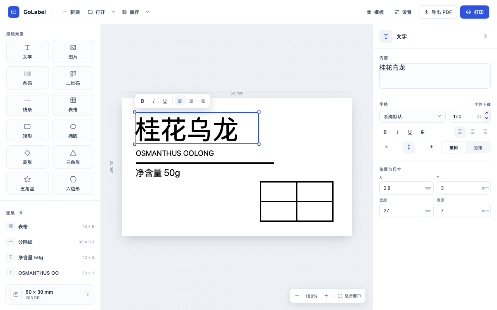
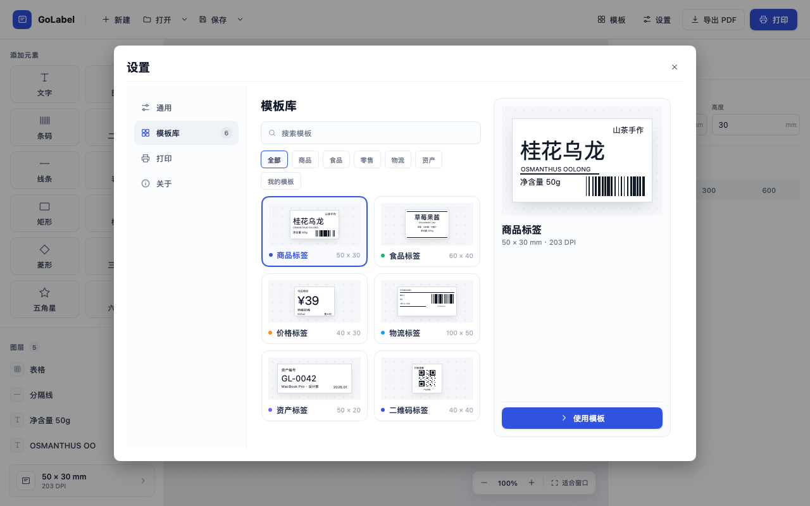

# GoLabel

[English](README.md) · 简体中文

面向 macOS 和 Windows 的原生标签编辑器，使用 Go 和 [MyGo](https://github.com/egoist/mygo) 构建。设计商品、包装、库存和物流标签，按实际尺寸打印，或导出 PDF。



## 功能

- **可视化编辑** — 拖动元素调整位置和大小，按毫米输入精确尺寸，配合标尺、缩放和对齐吸附完成排版
- **文字与图形** — 添加富文本、PNG/JPEG 图片、图形和线条，调整字体、对齐、横竖排、填充和线宽，最小线宽支持 0.1 mm
- **表格** — 合并单元格、设置单元格文字格式，拖动分隔线调整行高和列宽
- **条码与二维码** — 支持 Code 128 一维条码和二维码
- **模板库** — 使用内置标签样式，或将自己的设计保存为本地模板；`.golabel` 文件保留可编辑内容和内嵌图片
- **多标签页** — 在一个窗口中编辑多份标签，打开最近文件，异常退出后恢复未保存内容
- **打印与导出** — 预览标签，按 203、300 或 600 DPI 打印，导出与标签同尺寸的单页 PDF
- **语言与外观** — 支持简体中文和英文，以及浅色、深色和跟随系统外观



## 快速开始

从源码运行需先安装 Go 1.27.3 或更新版本，然后执行：

```sh
git clone https://github.com/viewhang/GoLabel.git
cd GoLabel
go run .
```

## 使用

1. 新建标签，设置纸张尺寸和打印机 DPI，或选择已有模板
2. 从左侧添加元素，在右侧修改属性；双击文字或表格单元格可直接在画布中编辑
3. 保存为 `.golabel`，方便后续继续编辑；需要复用设计时，在保存菜单中选择「保存为模板」
4. 点击「打印」预览并打印标签，或点击「导出 PDF」保存文件

调整单元格大小时，先选中表格，再拖动内部横线或竖线；拖动交点可同时调整行高和列宽。

打印前请安装标签打印机的系统驱动，并让驱动纸张尺寸与标签一致。间隙纸、黑标纸还需在驱动中设置对应纸张类型。打印导出的 PDF 时，选择「实际大小 / 100%」。建议先试印一张，确认尺寸和条码可读性。

## 从源码构建

在项目目录执行以下命令，产物输出到 `build/`。

### macOS

在 macOS 上构建当前机器架构的应用：

```sh
go run github.com/egoist/mygo/cmd/mygo@v0.9.0 build -skip-dmg
```

同时支持 Apple 芯片和 Intel Mac 的通用包：

```sh
go run github.com/egoist/mygo/cmd/mygo@v0.9.0 build -platform darwin/universal -skip-dmg
```

产物：`build/darwin-universal/GoLabel.app`。

### Windows

可在 Windows 本机编译，也可从 macOS 交叉编译：

```sh
go run github.com/egoist/mygo/cmd/mygo@v0.9.0 build -platform windows/amd64
```

产物位于 `build/windows-amd64/`，适用于 Windows 10/11 的 64 位 Intel/AMD 电脑：

- `golabel-setup-<version>-amd64.exe` — 安装版，提供开始菜单入口、卸载和 `.golabel` 文件关联
- `GoLabel.exe` — 免安装的单文件版

生成安装版需要 NSIS。macOS 上先运行 `brew install makensis`；Windows 上 MyGo 会在需要时下载。只需单文件版时，在构建命令末尾加上 `-skip-installer`。分享单文件版时，请附上同目录的 `THIRD-PARTY-NOTICES.txt`。

### 测试

```sh
go test ./...
```

## 发布

首个版本为 **v0.1.0**，标签须与 `mygo.json` 中的 `version` 一致，并添加 `v` 前缀。

提交并推送工作流与版本配置后，推送附注标签即可发布：

```sh
git tag -a v0.1.0 -m "GoLabel v0.1.0"
git push origin v0.1.0
```

GitHub Actions 会运行测试、构建并发布 [GitHub Release](https://github.com/viewhang/GoLabel/releases)，包含：

- `golabel-setup-0.1.0-amd64.exe` — Windows 安装版
- `golabel-0.1.0-windows-amd64.exe` — Windows 单文件版，附带 `THIRD-PARTY-NOTICES.txt`
- `golabel-0.1.0.dmg` — 同时支持 Apple 芯片和 Intel 的 macOS 通用版

macOS 应用使用 ad-hoc 签名，尚未经过 Apple 公证。

## 许可证

[MIT](LICENSE)
